# textpen

A code editor in the terminal pane: the project's files as a tree, tabs, search across
them, and the text in the colours and the font of your terminal — with the keyboard or
the mouse, on your machine or on a server over plain `ssh`.

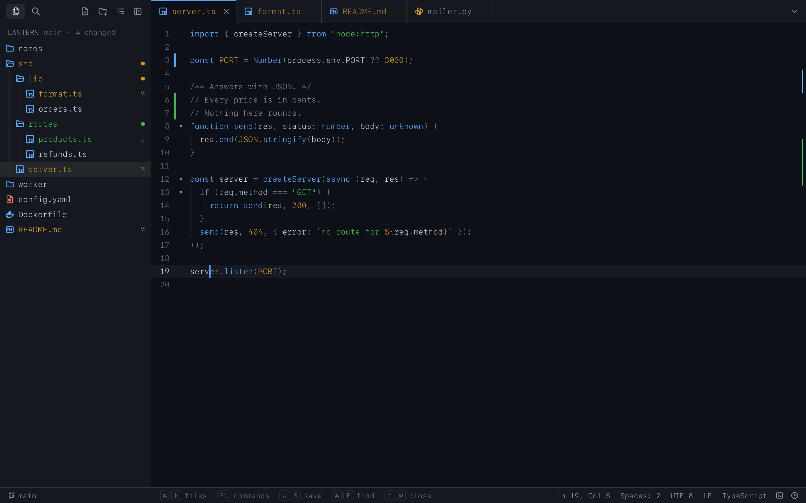

## Install

textpen is one file, with the editor inside it and nothing else to install, for macOS on Apple
silicon and Linux on `arm64` and `x86_64`:

```sh
curl -fsSL https://raw.githubusercontent.com/bateri/textpen/main/install.sh | sh
```

To see the editor you need a terminal that hosts pencere views: [bateri](https://github.com/bateri/bateri), from its 0.23. In any
other terminal textpen opens your own `$EDITOR`.

The installer takes the newest release (or `TEXTPEN_VERSION=0.2.0`), checks it against the
release's `SHA256SUMS`, and puts it in `~/.local/bin` (`TEXTPEN_INSTALL=<dir>` puts it elsewhere).
A file a browser downloads is quarantined by macOS; one curl downloads is not.

## Use

textpen is a [pencere](https://github.com/bateri/pencere) program. Run it in a terminal
that hosts pencere views ([bateri](https://github.com/bateri/bateri)) and the pane becomes
the editor, the way `vim` takes the screen and gives it back; quit and the shell is where
it was. Run it anywhere else and your own `$EDITOR` opens instead.

```sh
textpen                             # the folder you are in
textpen src/server.ts:42            # a file, at a line (`+42 file` works too)
textpen ~/projects/lantern          # a folder as the project
```

With no file named, textpen opens on the folder you are in, with the files that were open
there the last time. Settings are kept in `~/.config/textpen/`, drafts and each project's
open files in `~/.local/state/textpen/` (or where `XDG_CONFIG_HOME` and `XDG_STATE_HOME`
say).

**As your `$EDITOR`.** `export EDITOR=textpen` and `git commit` opens the message in the
pane: save it and close the tab, and git goes on. Opened on files named on the
command line, textpen ends when the last of them is closed. In a terminal without pencere it
passes the file to `$VISUAL` or `$EDITOR` — skipping itself — or to `vi`.

**Over ssh.** Copy the file for the server's system to it and run it there, in a pane of a
terminal that hosts pencere: nothing listens on a port, the editor travels in the terminal's
own stream, and it runs on your machine in a sandbox that reaches nothing but its program. Its
files cross the stream once; after that the terminal keeps them.

## What it does

<table>
  <tr>
    <td width="33%" valign="top">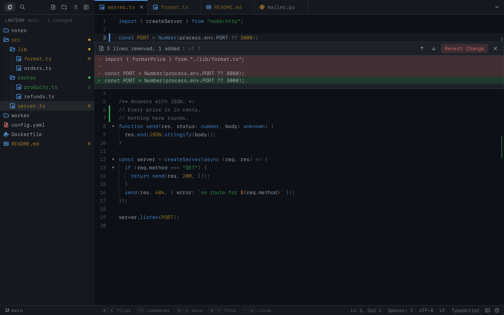<br>A change peeked: the lines as they were and as they are</td>
    <td width="33%" valign="top">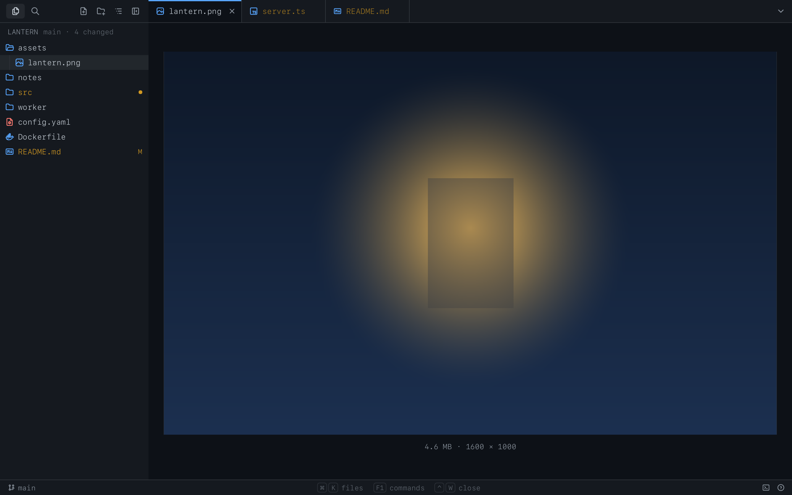<br>A picture in its tab: fitted, with its size and its pixels under it</td>
    <td width="33%" valign="top">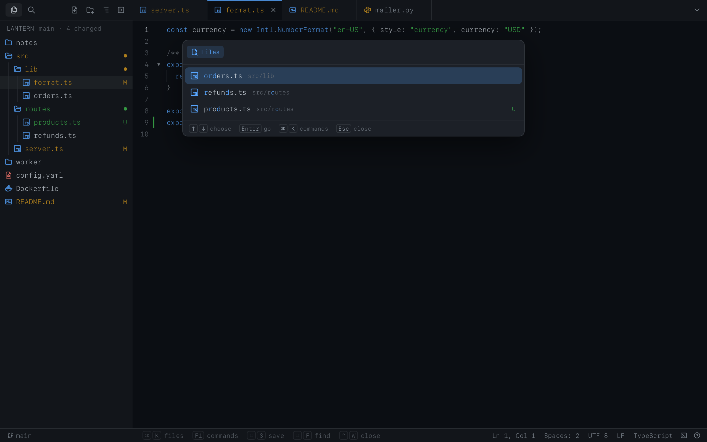<br>Go to a file</td>
  </tr>
  <tr>
    <td width="33%" valign="top">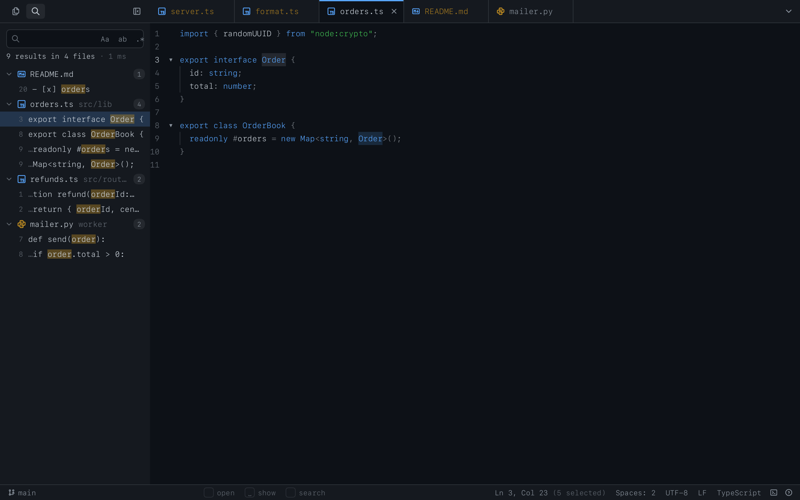<br>Search in the project</td>
    <td width="33%" valign="top">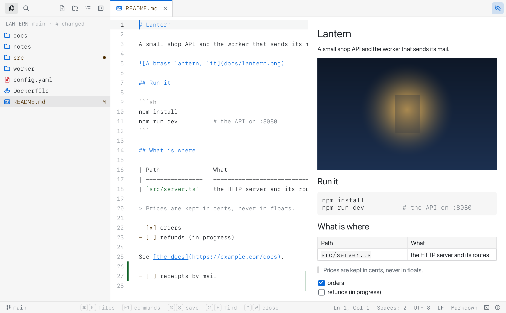<br>Markdown and its preview, in a light theme</td>
    <td width="33%" valign="top">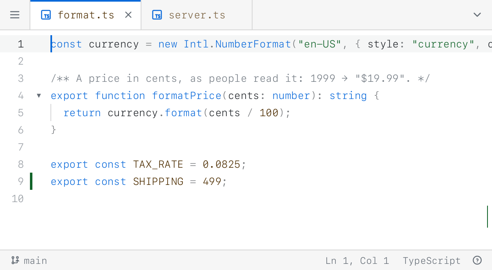<br>An 80×24 pane in a light theme</td>
  </tr>
  <tr>
    <td width="33%" valign="top">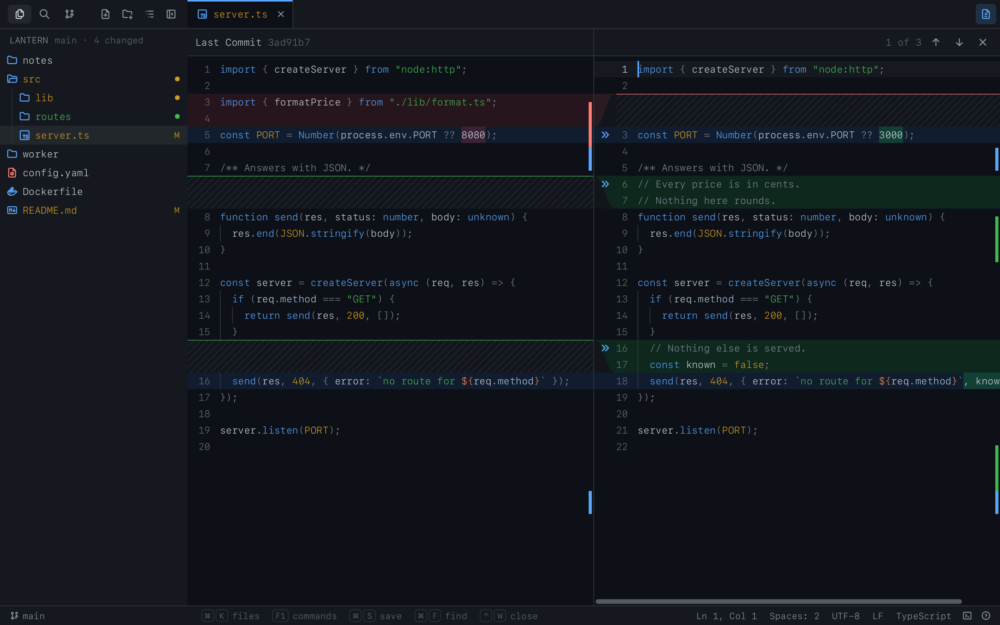<br>A file beside the last commit</td>
    <td width="33%" valign="top">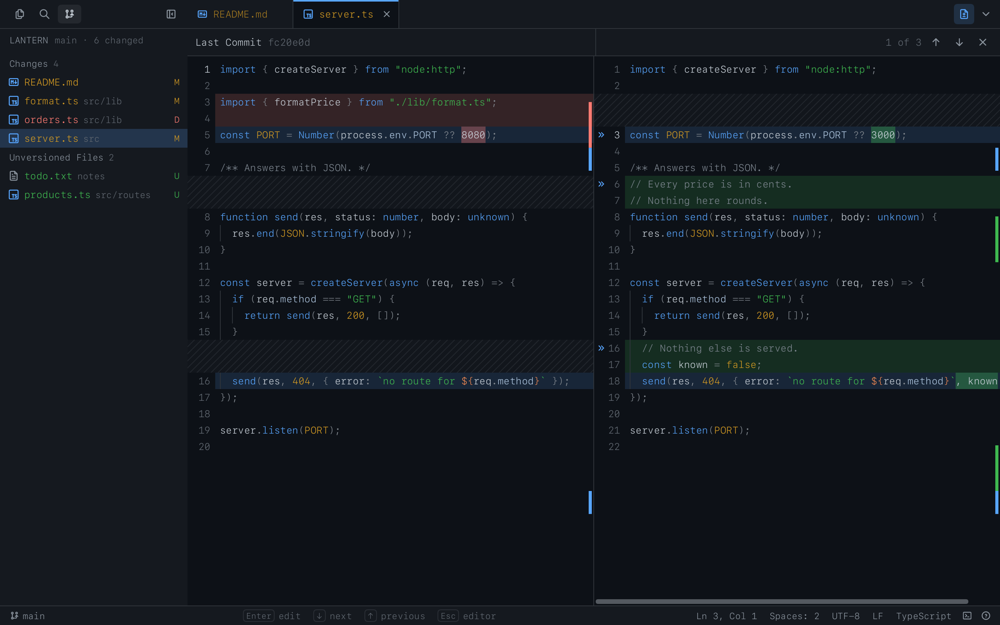<br>The changed files, each shown beside the last commit</td>
  </tr>
</table>

**The files of the project**, as a tree with what git says of each — changed, new, in
conflict, ignored, with all that is in a folder it ignores — and of the folders that hold them; which files are open and which have changes
that are not saved. Make, rename, move and delete files and folders from it. It follows the
file you are in, and shows every name whole: a tree narrower than its names scrolls across.

**An editor**, the terminal's own, drawn in its font, that reads 33 languages: the C family
(JavaScript, TypeScript, JSX, TSX, Rust, Go, C, C++, C#, Java, Kotlin, Swift, PHP), the
scripting ones (Python, Ruby, the shell, Lua), markup (HTML, XML, Markdown), data (JSON,
YAML, TOML, INI and `.env`), style sheets (CSS, SCSS, Less) and the files of the tools (SQL,
PostgreSQL's and SQLite's, the Dockerfile, the Makefile, a diff), each with its own comments,
indentation and folding; Markdown with the code in its fences read in their own languages. A
file's language is told by its name, its extension or its first line (`#!/usr/bin/env python3`).
Multiple cursors, folding (and fold all), bracket matching, the other places of what is
selected marked, find and replace in the file with a count of the matches, go to a line,
comment lines out, move, copy, join, split and delete them whole.

**What you changed since git's index, marked as VS Code marks it.** A bar down the gutter along
the lines you changed (blue) or added (green) and a small red triangle where lines were taken
away, the same on the editor's right edge so that a change in a long file is found; the bar is
wider under the pointer. Click one (or `⌥F5`, `⇧⌥F5` for the next and the previous change) and a
peek opens under it with the lines as they were on red and as they are on green, `Revert Change`
(an edit like any other: `⌘Z` brings the change back), the change before and after, and `Esc`
to close it. The original is what git's index keeps of the file, so a change you staged is no
longer marked, and a file git does not keep has no marks. They follow what you type, and the
setting `Changes in the gutter` (or Toggle Changes in the Gutter) turns them off.

**A file beside the last commit.** `⇧⌘D`, the button at the end of the tab strip or Compare with
Last Commit in the palette shows the file in two columns, as a git client does: what the last
commit keeps of it on the left, which cannot be changed, and the file itself on the right, which is
its own editor, so that you type, undo and save as ever. The lines that differ are in colour (red
taken away, green added, blue changed, and in a changed line the words that differ); the side that
has fewer lines has a hatched gap, so that the same lines stand at the same height, the colour of
a change crosses from one side to the other between them, and the two
scroll together, down and across. The long stretches that did not change are folded on both
sides, three lines kept either side of a change, and the arrows beside one open it (`⌘⌥]` at the
caret, `⌃⌥]` shows every line, `⌃⌥[` folds them again); a caret that goes into one, with Find or Go
to Line, opens it too. A chevron at the first line of a change takes it back (`⌃⇧⌫`): the lines as
the commit has them replace it, as one edit that `⌘Z` undoes. The header names the commit, counts
the changes (`1 of 5`) and goes to the next and the previous (`⌥F5`, `⇧⌥F5`); `Esc` closes it. A
file taken away shows what the commit has against nothing, a renamed one is read under its old
name, and one git does not keep is all added. A binary file, a file outside a git repository and
a file of more than 2 MiB or 50 000 lines are not laid out so, and the page says why.

**The changed files.** The sidebar has a third panel beside Files and Search, `⇧⌘G`: the files git
says are changed, and below them those it does not keep, each with its icon, its folder and its
letter. A click, or an arrow, shows the file beside the last commit and leaves the keys in the
panel, so that you go through a change set file by file; `⏎` goes into the editor. A file the
panel opened that you did nothing in is closed as the next comes.

**Every colour is the terminal's.** A terminal gives its view a handful of colours — its
background and foreground, a dimmed one, an accent, and the colours it says success, danger,
warning and information with — and textpen draws code with those, as the theme's author
chose them to read on that background: keywords in the accent, strings in the success
colour, numbers in the warning one, types in the information one. Change the terminal's
theme and the editor follows, live.

**Search in the project's files**, as words, whole words or patterns, with the matches by
file; go through them from anywhere with `F4` and `⇧F4`.

**Pictures**: a PNG, a JPEG or an SVG opens in its tab, fitted into it and not made larger, with its
size and its pixels under it. A file past 8 MiB or 4096 pixels is not drawn, and says so. It needs
a terminal that shows the page at `lua` 0.1, as bateri does.

**Drop a file on the tree** to put it in the project: dragged over a folder (or a file, which is
its folder, or the room under the rows, which is the project) the place is marked and named, and
dropped, each file is a faint row there with how far it has got, and a Cancel under the pointer.
A name that is taken is asked about once, Replace or Keep Both; nothing is written over a file
unasked, and a file given up leaves no half file. From the keyboard, **Upload Files** (a folder's
right-click menu, or the command palette with a folder chosen in the tree) asks the terminal for
the Open panel and puts what you choose in that folder, and **Download** (a file's menu, or the
palette) asks for the Save panel with the file's name and says "Downloaded foto.png" when it is
written. In a Markdown file, `⌘V` with a picture on the pasteboard puts it beside the file as
`image.png` (`image-1.png`, `image-2.png` where the name is taken) and writes ``
at the caret; the preview holds its place until it is whole. A pause of a few seconds leaves the percent where
it is; with no word for 30 seconds the row says "Upload stalled" and offers **Retry**. It needs a terminal that shows the
page at `lua` 0.1, as bateri does.

<details>
<summary>Five pictures of an upload</summary>

<table>
  <tr>
    <td width="33%" valign="top">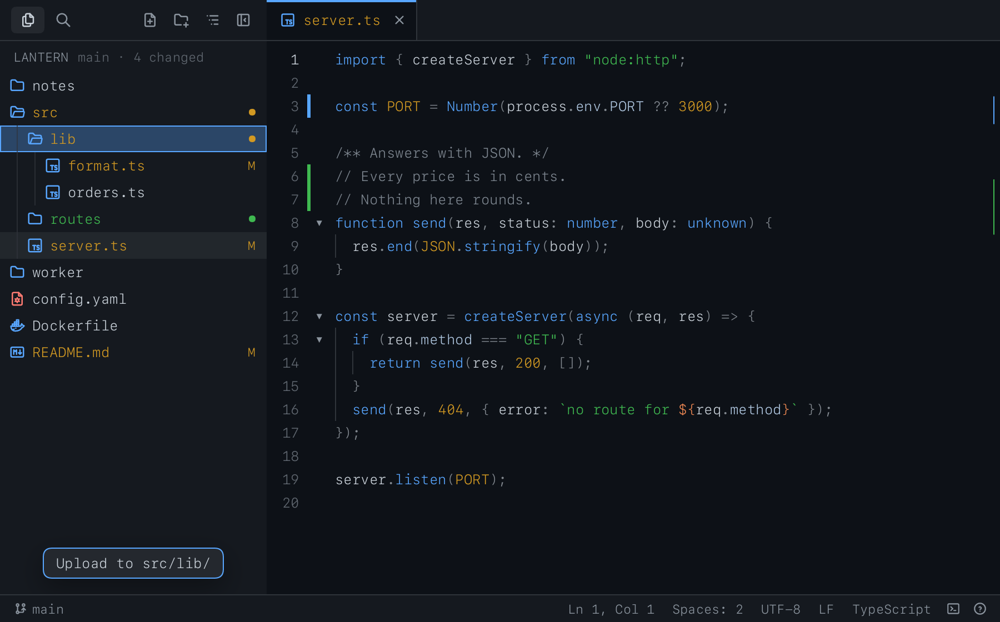<br>Dragged over a folder</td>
    <td width="33%" valign="top">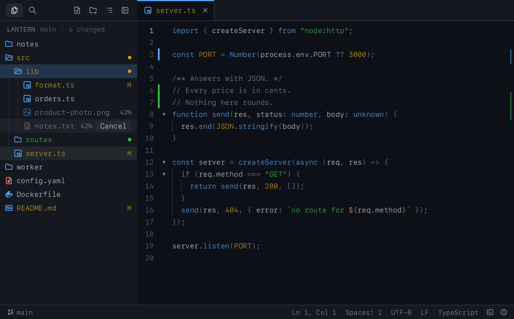<br>Two files on their way</td>
    <td width="33%" valign="top">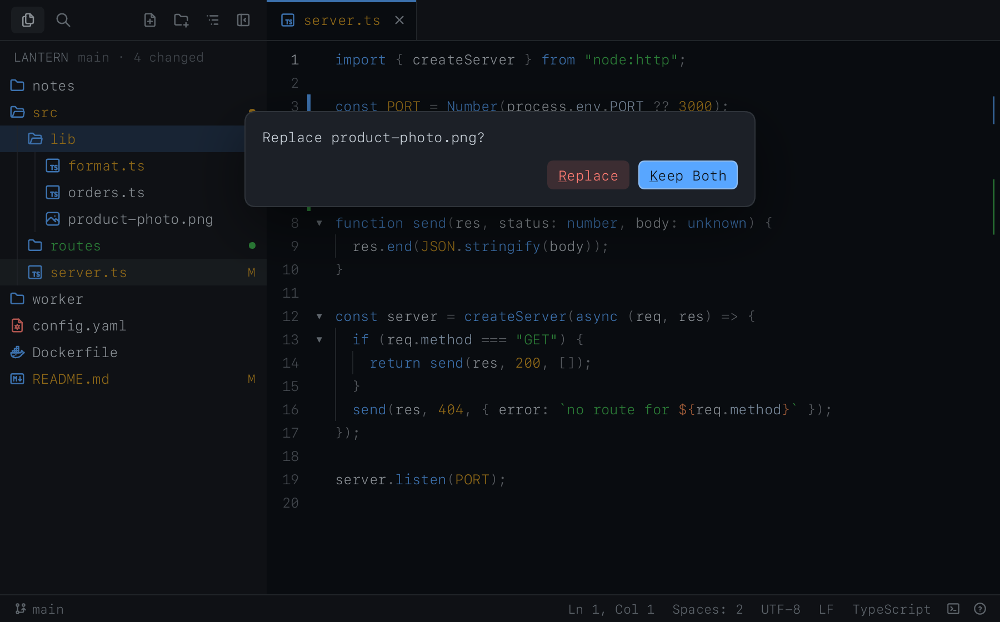<br>A name that is taken</td>
  </tr>
  <tr>
    <td width="33%" valign="top">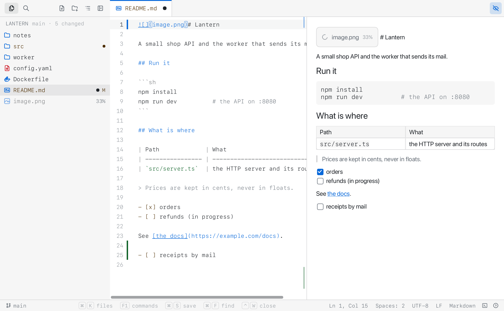<br>A picture pasted in a Markdown file</td>
    <td width="33%" valign="top">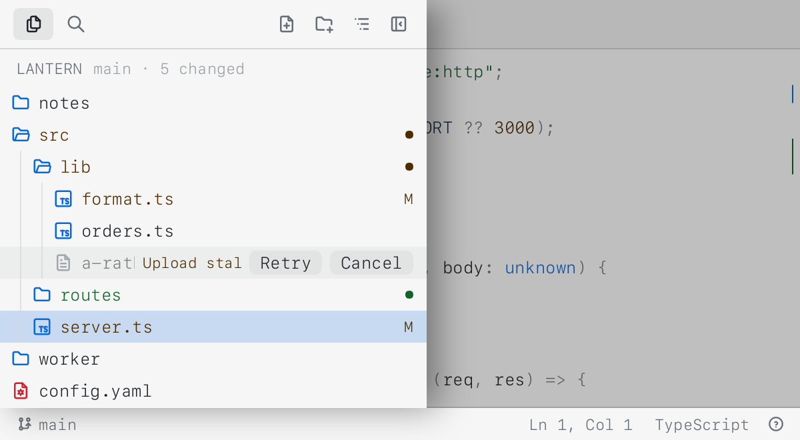<br>An upload that stalled, in an 80×24 pane</td>
  </tr>
</table>

</details>

**A preview of Markdown**, beside the text in a wide pane and in its place in a narrow one,
read again only where you changed the text, and shown to its end for a long file. The pictures it
names (``, found from the file's own folder, in the project) are drawn, fitted to the
width of the text; the others stay their words.

**Nothing is lost to a ⌃C.** textpen keeps what you have not saved, and when it ends — a
⌃C, a dropped connection — it writes a draft; open the file again and it offers to bring
the changes back. A file another program changes is read again when you have no changes of
your own, and when you do, textpen asks which to keep, and does not write over it without
asking.

**A shell in the pane.** `⌘J` hands the pane to a shell in the project's directory; `exit`
brings the editor back, where you left it, unsaved changes and all.

**It fits the pane.** In a wide pane the files are beside the editor, the edge between them
dragged where you want it; in a narrow one (80×24) they slide over it with `⌘B`, and the
status line keeps what still fits.

**What it does not do.**

- `--dev` is refused: `make dev` in textpen's checkout runs it from its files and shows the editor
  again when they change ("Work on it").
- Search in the project reads the files one after another, on a thread of its own, so a search of
  a very large project may take longer than if they were read several at a time. Typing and the
  other calls go on while it runs.
- A pattern in the project search is a Rust regular expression, not a JavaScript one: `\d`, `\w`
  and `\b` mean Unicode digits, letters and word edges, and back-references (`\1`), look-ahead
  and look-behind are refused with a message. In return a search always ends in time linear in
  the text, whatever the pattern. A whole-word search takes the match the pattern prefers at a
  place, so `foo\s*` in `foo  bar` is not a whole word. Find and replace in a file is the
  editor's own.
- A file whose name is not valid UTF-8 is not shown in the tree and is not searched.
- Names are ordered with numbers as numbers (`file9` before `file10`) and capitals with small
  letters, in the tree and in a search alike; letters with accents are not folded (`é` comes
  after `z`).

## The keyboard, and the mouse

Everything the mouse does, the keys do too: the palette has every command, the status line
says what the keys do where you are, and `F1` lists them all. The keys a terminal keeps for
itself never reach a view — in bateri `⌘P`, `⌘W`, `⌘O`, `⌘T`, `⌘N`, `⌘D` and `⌘1`–`⌘9` are
its tabs, splits and windows — so textpen's commands are on keys it leaves free, and every
one is in the palette. No command is on `⌥` and a letter: on a Mac that is how many layouts
type `@`, `#`, `[` or `{`.

|                            |                                                                           |
| -------------------------- | ------------------------------------------------------------------------- |
| `⌘K`                       | go to a file (`name:12` goes to a line); `⌘K` again, or `>`, the commands |
| `F1`                       | every command                                                             |
| `⌘E`                       | the open files, by when you last saw them                                 |
| `⌘S`, `⌥⌘S`                | save, save all                                                            |
| `⌃W`, `⇧⌘T`                | close the tab, open the one closed last                                   |
| `⌃PgUp` `⌃PgDn`, `⌃1`–`⌃9` | the previous and next tab, a tab by its place                             |
| `⌘B`, `⇧⌘E`, `F6`          | the files: show or hide, go to them, between them and the editor          |
| `⌘F`, `⌥⌘F`, `⇧⌘F`         | find, replace, search in the project                                      |
| `⌘L`                       | go to a line                                                              |
| `⌃G`, `⇧⌘L`, `⌃⇧↑` `⌃⇧↓`   | add the next match, every match, a cursor above or below                  |
| `⌘/`, `⌥↑` `⌥↓`, `⇧⌘K`     | comment, move the line, delete it (`⌃⇧K` too)                             |
| `⌘I`, `⌃J`, `⌃⌥[`          | select the line, join lines, fold all                                     |
| `⌥F5`, `⇧⌥F5`              | the next and the previous change against git, with its peek (`⌃⇧⌫` reverts it), or in the comparison |
| `⇧⌘D`, `⇧⌘G`               | the file beside the last commit, the panel of the changed files           |
| `⌘⌥]`, `⌃⌥]`, `⌃⌥[`        | in the comparison, open the stretch at the caret, show every line, fold   |
| `⇧F10`                     | the editor's right-click menu, at the caret                               |
| `⇧⌘V`                      | the preview of a Markdown file                                            |
| `⌘,`, `⇧⌘/`                | the settings, every key                                                   |
| `⌘J`                       | a shell in the project, in this pane                                      |
| `⌃Q`                       | quit, asking about what is not saved                                      |

The tree has the keys once you click a row in it, or press `⇧⌘E` or `F6`; then `j` `k` and
the arrows move, `h` `l` fold and unfold, `⏎` opens, `a` makes a file and `A` a folder, `r`
renames or moves, `d` deletes, `y` copies the path, `.` opens the menu of the row. `Esc`
goes back to the editor from anywhere. The panel of the changed files has the same keys that go
through it (`j` `k` and the arrows, `⏎` into the editor, `y` copies the path, `.` opens its menu). The keys the status line shows are buttons too: a
click does what the key does.

`⌃C` always reaches textpen and ends it, whatever has the keyboard; what is not saved is
kept as a draft. The text is the size the terminal draws its own: its own keys make it larger
or smaller, and textpen has no zoom of its own.

## How it works

- `src/program/` is textpen's program, in Rust on the [pencere](https://github.com/bateri/pencere)
  crate, and **holds the text of every open file**. The editor asks it with a handful of calls
  (open, edit, save, list and search) and hears from it on one topic, what changed on disk and in
  git; `docs/calls.md` is all they say to each other. What the editor sends travels through the
  terminal's input queue, in frames of 511 bytes and messages of at most 1 MiB, so it never sends
  a file: it sends what changed, a few hundred milliseconds of typing at a time, as replacements
  made on a version of the text the program checks, in places counted in bytes; saving is a
  word to the program. A message the other way is at most 1 MiB too, so a long text, a long folder
  and the files of a big project come to the editor in pieces. Holding the text is also what lets
  it outlive the view — a shell, a restart of the terminal — and become a draft when the program
  ends.
- `src/program/terminal/` is the part that knows about the terminal: the command line, the pane
  lent to a shell and taken back, and your own editor in a terminal that shows no views;
  `src/program/main.rs` shows the view in the pane.
  `src/program/README.md` has the modules.
- `src/view` is the editor: a page of pencere's kit, in Lua, which the terminal runs and draws
  itself, with [Tabler icons](https://tabler.io/icons) in `src/assets/`.
- `cargo build --release` builds the program with the page and the pictures in it (`build.rs`):
  `target/release/textpen`, about 4 MB.

## Work on it

You need Rust 1.88 ([rustup](https://rustup.rs)) and git; nothing else is installed, and nothing
needs Node but the release tool (`tools/release.mjs`) and the one that draws the icons
(`tools/icon.mjs`).

```sh
git clone https://github.com/bateri/textpen && cd textpen
make fake-host      # pencere's stand-in terminal, of the pencere Cargo.lock takes, in .cache/pencere
make check FAKE_HOST=.cache/pencere/target/debug/pencere-fake-host
make build          # target/release/textpen
make dev            # textpen from its files, in a pane of a terminal that hosts pencere views
```

`make check` is the gate: rustfmt, clippy, and the program's tests, its own and the ones that run
it in a pane under `pencere-fake-host`, the stand-in terminal, and hold its calls, drafts and
command line to `docs/calls.md`. `FAKE_HOST` is `../pencere/target/debug/pencere-fake-host` unless
it is told otherwise: a checkout of pencere beside this one, with the stand-in built there (`cargo
build -p pencere-fake-host`). No test is skipped: a stand-in that is not there stops the run and
says which. `make check` runs the page's tests too (`make test-page`): `src/view/` run as a
terminal runs it, on pencere's host with no screen, with the program's own handlers in the same
process — opening, typing and saving, a long text in pieces, a conflict, a draft, the tree, the
palette over twenty thousand files, find and replace, the project's search, the preview, the shell
and back, an 80×24 pane. A call of the page is held to 10 s there, not to the kit's 250 ms, which
is the wall clock's and fails a slow or busy runner for nothing the page did: `make check-timing`
(`CALL_MS=125` for half the time) runs the same tests with the kit's 250 ms, on a machine at rest.
`make shots` draws the pictures of `docs/` from the page as it is, in the
fonts of a Mac. CI runs `make check` on Linux and macOS.

`make dev` builds the `pencere` command of the pencere `Cargo.lock` takes, in `.cache/pencere`,
and runs `pencere dev`: textpen is built and run in the pane, the editor is shown again when a file
of `src/view/` or `src/assets/` changes, and the program is built and run again when one of its own
does. `make dev PENCERE_SRC=../pencere` uses a checkout you are changing instead. `demo/` is a
small shop to open textpen on (`textpen demo`).

How a version is released is in [RELEASING.md](RELEASING.md), and what each one changed in
[CHANGELOG.md](CHANGELOG.md).

## License

textpen is free software: you can redistribute it and/or modify it under the terms of the
[GNU General Public License](LICENSE) as published by the Free Software Foundation, either
version 3 of the License, or (at your option) any later version. It is distributed in the
hope that it will be useful, but WITHOUT ANY WARRANTY; see the license for details.
